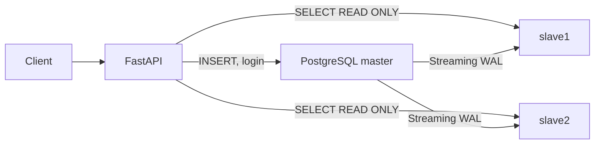
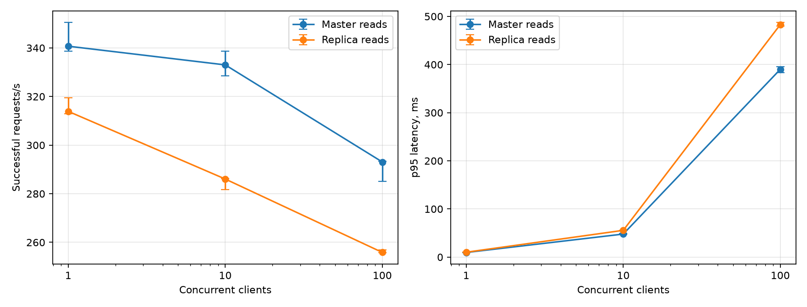

# ДЗ №3. Репликация PostgreSQL

Что сделано в этой работе: к приложению из ДЗ №1–2 подключены две физические реплики PostgreSQL, чтение перенесено с master на реплики, запись осталась на master. Дальше — три проверки: замер нагрузки на чтение до и после переноса, подтверждение переноса по `pg_stat_statements` и две аварии master с SIGKILL, где async и кворумная синхронизация сравниваются по потерям подтверждённых транзакций.

Как поднять стенд и повторить эксперименты — [replication/README.md](../../replication/README.md). Исходный код: [репозиторий](https://github.com/branchylog981/course-OTUS-HighLoad-2026-09).

## Конфигурация и маршрутизация

Кластер собран на PostgreSQL 17: один master и две физические hot standby, у каждой свой Docker volume. Реплики создаются через `pg_basebackup -Xs -R` — он сразу оставляет `standby.signal`, и WAL дальше идёт потоком. Имена узлов в репликации — `slave1` и `slave2` (их `application_name`). Основные настройки: `wal_level=replica`, `max_wal_senders=10`, `hot_standby=on`, `wal_keep_size=512MB`.

Репликационные слоты я сознательно не использовал. Обратная сторона такого решения: если реплика отстанет дальше, чем сохранено WAL на master, её придётся пересоздавать заново. Для учебного стенда это приемлемо, зато нет риска, что «зависший» слот молча забьёт диск master. Patroni не подключался — переключение здесь ручное, им управляет учебный скрипт, об этом ниже.

Роль для репликации — `replicator` с LOGIN и REPLICATION, вход по SCRAM разрешён в `pg_hba.conf`. Роли узлов, версия PostgreSQL, индексы и настройки read-кластера сохранены в [cluster.json](cluster.json).

В приложении маршрутизацией занимается `ReadRouter` (`app/routing.py`). `get_profile()` (это `/user/get/{id}` и `/user/me`) и `search()` (это `/user/search`) берут соединение из двух пулов по 5 соединений и ходят по репликам round-robin. На соединениях включён `read_only=True`, то есть транзакции реально выполняются как `BEGIN READ ONLY`. Если получить соединение с одной реплики не вышло, попытка уходит на другую; начатую транзакцию я не повторяю — её результат уже неоднозначен. У записи отдельный пул на 10 соединений: регистрация и проверка пароля при логине всегда идут на master. Если же `READ_HOSTS` пуст, всё работает с master — так получается исходный режим ДЗ №1–2, он оставлен для сравнения.

Один нюанс, который стоит держать в голове: при асинхронной репликации чтение сразу после записи может вернуть старые данные или 404. Логин этому не подвержен — он всегда читает master. А если недоступны обе реплики, чтение отвечает 503 и автоматически падать обратно на master не умеет. Я оставил такое поведение намеренно: видимая ошибка лучше, чем тихое чтение с master, которое маскирует проблему с репликами.

## Нагрузка на чтение

Замер начат `2026-11-10T12:04:52.300528+00:00` (UTC). В базе миллион анкет из people.v2.csv — тот же массив, что в ДЗ №2, составной B-tree индекс на месте. Состав массива и SHA-256 источника: [seed.json](seed.json).

Смесь простая: 50% `GET /user/get/{id}` и 50% `GET /user/search`. UUID берутся детерминированно из существующих анкет, в поиске по кругу чередуются частые, редкие и отсутствующие префиксы из ДЗ №2. Фоновой записи в этом эксперименте нет. Порядок фаз: сначала master, потом две реплики. Точный состав запросов, SHA-256 ответов, ресурсы и исходные показатели — [reads.json](reads.json).

Методика такая. Одновременность 1, 10 и 100 клиентов, на каждой точке 3 повтора; перед повтором 3 секунды прогрева, затем окно измерений 15 секунд. Клиенты closed-loop: отправили запрос, дождались ответа, отправили следующий. Keep-alive включён, таймаут 15 секунд; начатые к концу окна запросы дожидаются ответа и попадают в статистику. Latency считается до полного чтения тела, RPS — успешные ответы на всё время с завершением очереди. Каждый ответ во время нагрузки сверяется по SHA-256 тела; в обеих фазах ответы совпали. Сырые логи запросов — [raw/](raw/).

По ресурсам: каждой БД — 2 CPU и 2 GiB (`shared_buffers=256MB`), приложению столько же. Все контейнеры на одном Docker-хосте, генератор работает на хостовой машине. В обеих фазах запущены все три БД, суммарный пул чтения — 10 соединений. Поэтому это сравнение перераспределения SQL-нагрузки на данном стенде, а не доказательство линейного масштабирования: разнеси я узлы по отдельным серверам, цифры были бы другими.

В таблице медианы повторов, для RPS в скобках min–max. p95/p99 — медианы перцентилей отдельных повторов, а не перцентили объединённой выборки.

| Чтение | Клиенты | Метод | RPS (min–max) | p50, мс | p95, мс | p99, мс | Ошибки |
|---|---:|---|---:|---:|---:|---:|---:|
| master | 1 | get | 170.4 (169.3–175.2) | 1.61 | 1.99 | 2.23 | 0 |
| master | 1 | search | 170.4 (169.3–175.2) | 2.36 | 10.16 | 11.51 | 0 |
| master | 1 | total | 340.7 (338.6–350.5) | 1.77 | 9.57 | 10.86 | 0 |
| master | 10 | get | 166.5 (164.3–169.3) | 26.85 | 37.27 | 48.11 | 0 |
| master | 10 | search | 166.5 (164.3–169.3) | 30.28 | 51.95 | 61.27 | 0 |
| master | 10 | total | 333.0 (328.6–338.7) | 28.16 | 47.86 | 56.96 | 0 |
| master | 100 | get | 146.5 (142.5–146.7) | 332.50 | 375.07 | 390.90 | 0 |
| master | 100 | search | 146.6 (142.5–146.7) | 343.62 | 400.16 | 430.49 | 0 |
| master | 100 | total | 293.1 (285.1–293.3) | 336.91 | 390.08 | 418.95 | 0 |
| replicas | 1 | get | 157.0 (156.4–159.8) | 1.80 | 2.23 | 2.54 | 0 |
| replicas | 1 | search | 156.9 (156.5–159.8) | 2.59 | 10.77 | 12.22 | 0 |
| replicas | 1 | total | 313.9 (312.9–319.6) | 1.97 | 10.13 | 11.45 | 0 |
| replicas | 10 | get | 143.0 (140.9–143.2) | 31.36 | 42.29 | 54.39 | 0 |
| replicas | 10 | search | 143.1 (140.9–143.1) | 35.29 | 59.49 | 70.74 | 0 |
| replicas | 10 | total | 286.1 (281.8–286.3) | 32.91 | 55.60 | 65.78 | 0 |
| replicas | 100 | get | 127.9 (127.9–128.4) | 378.63 | 475.17 | 500.94 | 0 |
| replicas | 100 | search | 128.0 (127.9–128.5) | 390.08 | 492.64 | 524.21 | 0 |
| replicas | 100 | total | 255.9 (255.7–256.9) | 384.94 | 483.04 | 514.55 | 0 |

Сравнение медианного суммарного throughput:

- 1 клиентов: 340.7 → 313.9 RPS (-7.9%).
- 10 клиентов: 333.0 → 286.1 RPS (-14.1%).
- 100 клиентов: 293.1 → 255.9 RPS (-12.7%).

Главный вывод получился неожиданным: перенос чтения на реплики throughput не увеличил, а немного снизил, причём при любой одновременности. Ошибок при этом ноль — за все окна измерено 82,543 HTTP-ответа. Master от SELECT действительно освобождён (ниже отдельное доказательство), но быстрее HTTP-путь от этого не стал. Почему именно так — я не профилировал, и этот замер сам по себе не позволяет повесить разницу только на PostgreSQL: на результате заметно сказываются FastAPI с сериализацией ответов и сам генератор, да и рост числа реплик по умолчанию ничего не гарантирует.

## Доказательство переноса чтения

Отдельно проверил, что чтение действительно уходит с master, а не просто «так кажется» по RPS. Для каждого прогона сняты дельты локальных `pg_stat_statements` на всех трёх узлах; прогрев исключён, считаются только SELECT двух API-методов по форме SQL. Сценарий дополнительно сверяет, что сумма SQL-вызовов совпадает с числом успешных HTTP-ответов отдельно по каждому методу. `exec_ms` — суммарное время выполнения этих SQL, без HTTP и очередей.

| Фаза | Узел | get SELECT | search SELECT | SQL execution, мс |
|---|---|---:|---:|---:|
| master | master | 21884 | 21887 | 12222.30 |
| master | slave1 | 0 | 0 | 0.00 |
| master | slave2 | 0 | 0 | 0.00 |
| replicas | master | 0 | 0 | 0.00 |
| replicas | slave1 | 9737 | 9649 | 5538.02 |
| replicas | slave2 | 9648 | 9738 | 5991.43 |

Картина однозначная. В фазе master оба SELECT живут только на master, реплики пустые. В фазе replicas на master ноль вызовов, а реплики делят нагрузку практически пополам. То есть перенос чтения — факт; просто на этом стенде он не конвертируется в HTTP-throughput по причинам из предыдущего раздела.

## Авария master и потери транзакций

Центральный эксперимент работы. Для каждого режима поднимается отдельный пустой кластер, чтобы результаты не смешивались.

Генератор пишет в таблицу `replication_probe(run_id, seq, payload)` — одна строка и отдельный COMMIT на итерацию. Учёт построен так: seq попадает во внешний JSONL-журнал (с flush/fsync) только после успешного возврата COMMIT клиенту. То есть журнал — это ровно те транзакции, которые клиент считал подтверждёнными. Прогон длится 8 секунд; после первых подтверждений и ещё 3 секунд master получает `docker compose kill -s SIGKILL master`. Генератор дорабатывает своё окно до конца, ошибки подключения учитываются отдельно. Promotion не начинается, пока генератор не закончил.

### Async

Тут нужна оговорка. В чистом async потеря — дело случая: повезёт, и WAL успеет доехать до реплик до падения. Чтобы показать потерю гарантированно, перед записью я отключил обе репликационные сети: master отстал контролируемо, но продолжал спокойно подтверждать COMMIT. После аварии сети вернул. Это демонстрация того, что потеря подтверждённых транзакций вообще возможна при сочетании разрыва репликации и отказа master, а не утверждение, что каждый отказ async-мастера что-то теряет.

### Quorum

Сети не трогаются, вместо этого включена синхронизация: `synchronous_standby_names = 'ANY 1 (slave1, slave2)'`, `synchronous_commit = on`. COMMIT подтверждается только после локального flush и flush WAL хотя бы на одной из двух реплик — то есть подтверждённая запись живёт минимум на 2 из 3 узлов. `sync_state=quorum` у обеих реплик проверен перед нагрузкой. Цена вопроса: если недоступны обе реплики, подтверждение записи блокируется. И ещё тонкость: режим `on` гарантирует remote flush, но не немедленную видимость данных на чтении — для этого нужен `remote_apply` и учёт того, какая именно реплика подтвердила запись.

### Что происходит при переключении

Перед promotion я проверил, что старый master остановлен и его WAL-приёмники отключились. Кандидат выбирался по максимальному `pg_last_wal_receive_lsn()` — это durable WAL, то, что физически доехало до реплики; заодно сохранялся replay LSN. Дальше `pg_promote(true, 60)` завершает recovery, у второй реплики меняется `primary_conninfo`, и я дожидаюсь streaming и достижения LSN нового master. Для такой короткой аварии ни слоты, ни перезаливка не понадобились. Старый master остаётся выключенным: без `pg_rewind` или нового basebackup его нельзя возвращать самостоятельным primary.

### Результаты

| Режим | Попытки | Подтверждено клиенту | Сохранилось | Потеряно подтверждённых | Сохранилось без ACK | Новый master |
|---|---:|---:|---:|---:|---:|---|
| async | 512 | 508 | 0 | 508 | 0 | slave1 |
| quorum | 432 | 429 | 429 | 0 | 0 | slave1 |

Разница между режимами видна невооружённым глазом: в async не выжило ни одной подтверждённой транзакции, в quorum — все.

Сравниваются множества seq, а не просто количества строк: потеря — это «подтверждено клиенту» минус «осталось на новом master». Строки, сохранившиеся без клиентского ACK, выделены отдельно: COMMIT на master мог успеться, а ответ при аварии потеряться. Это не потерянные подтверждённые транзакции.

| Режим | Кандидат | Receive LSN перед promotion | Replay LSN перед promotion |
|---|---|---|---|
| async | slave1 | 0/4001CA8 | 0/4001CA8 |
| async | slave2 | 0/4001CA8 | 0/4001CA8 |
| quorum | slave1 | 0/4083788 | 0/4083788 |
| quorum | slave2 | 0/4083788 | 0/4083788 |

В обоих сценариях реплики имели одинаковый LSN, так что выбор кандидата был тривиальным.

После переключения конфигурация API обновляется, и контейнер приложения пересоздаётся с `--no-deps` — так старый master не запустится. В обоих экспериментах после аварии регистрация, чтение анкеты, поиск и логин вернули HTTP 200; синхронный режим на новом master сохранён с оставшейся репликой. Поиск отвечал 200 и до promotion, при уже остановленном master (в async — после восстановления сетей).

Насчёт масштаба честно: переключение ручное, автоматизировано учебным скриптом, и на время отказа с переконфигурацией запись недоступна. Никакого нулевого downtime здесь нет и не заявляется.

Доказательства: [failover-async.json](failover-async.json), [failover-quorum.json](failover-quorum.json); клиентские итоги: [writes-async.json](writes-async.json), [writes-quorum.json](writes-quorum.json); внешние журналы ACK: [async](writes-async.jsonl), [quorum](writes-quorum.jsonl).

## Источники

- [Спецификация API OTUS](https://github.com/OtusTeam/highload/blob/master/homework/openapi.json).
- [PostgreSQL 17: streaming и synchronous replication](https://www.postgresql.org/docs/17/warm-standby.html).
- [Настройки репликации, ANY и synchronous_standby_names](https://www.postgresql.org/docs/17/runtime-config-replication.html).
- [synchronous_commit](https://www.postgresql.org/docs/17/runtime-config-wal.html#GUC-SYNCHRONOUS-COMMIT).
