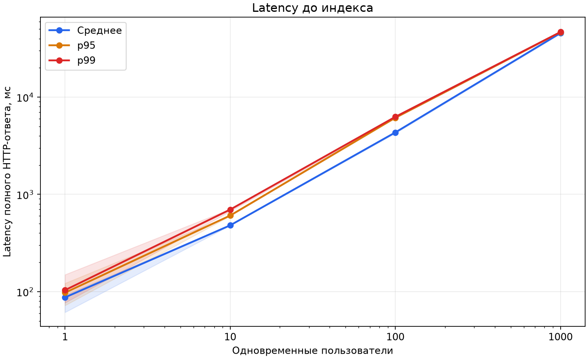
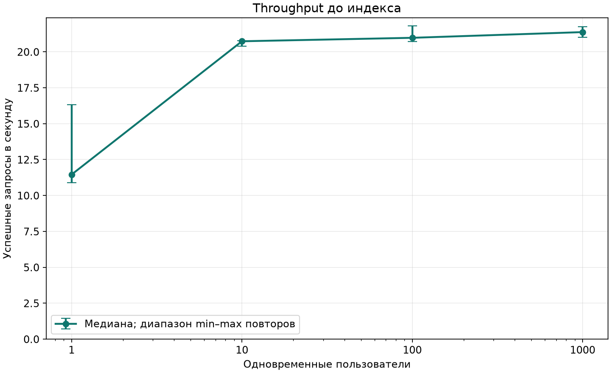
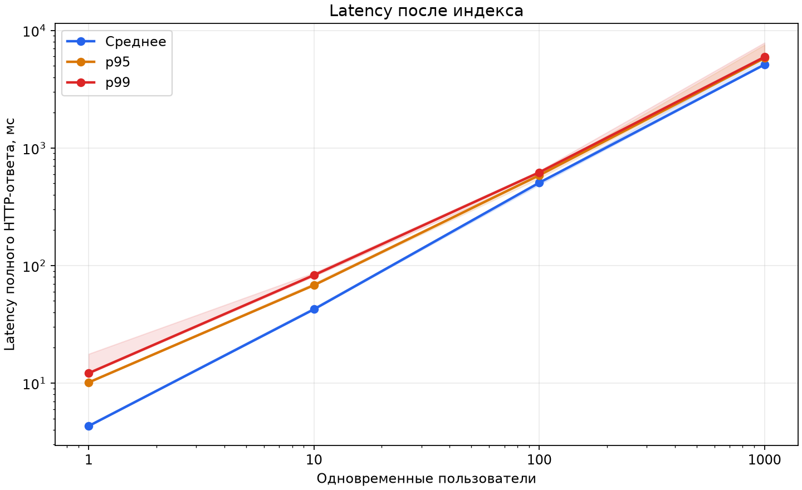
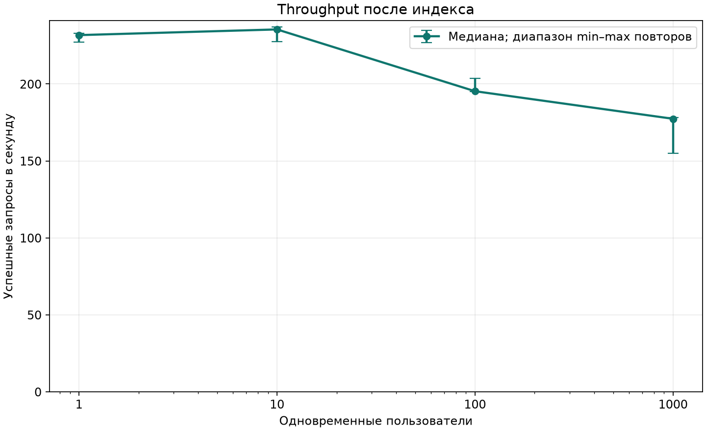

# ДЗ №2. Поиск анкет и индексирование

В этой работе один вопрос: что даёт правильный индекс префиксному поиску на миллионе строк. Ответ искал честным HTTP-тестом `/user/search`: до и после индекса один и тот же код приложения, те же данные, ресурсы и набор запросов. Единственная разница между фазами — индекс `idx_users_name_prefix` и обновление статистики `ANALYZE`.

## Стенд

Эксперимент начался `2026-11-02T08:40:28.213592+00:00` и закончился `2026-11-02T08:50:07.088108+00:00` (UTC) — весь прогон уложился примерно в десять минут.

- Хост: `Linux-6.18.33.2-microsoft-standard-WSL2-x86_64-with-glibc2.43`, Docker `29.9.2`, 12 vCPU, 23.5 GiB памяти.
- PostgreSQL: `PostgreSQL 17.11 (Debian 17.11-1.pgdg12+2) on x86_64-pc-linux-gnu, compiled by gcc (Debian 12.2.0-14+deb12u1) 12.2.0, 64-bit`.
- БД ограничена 2 CPU / 2 GiB, приложению — столько же; генератор нагрузки работает на хосте.
- Настройки БД: `shared_buffers=512MB`, `max_parallel_workers_per_gather=0`, `lc_collate=en_US.utf8`, `work_mem=4096 kB`. Параллелизм SQL я отключил специально: иначе в замер подмешивался бы параллелизм самого PostgreSQL, а сравнить хотелось именно клиентскую одновременность.
- Один процесс Uvicorn, штатный пул psycopg от 1 до 10 соединений, ожидание пула 5 с, SQL statement timeout 5 с. Код и конфигурация идентичны в обеих фазах.
- Клиент: Python 3.14.4, aiohttp 3.14.5, HTTP/1.1 keep-alive. Ресурсы, образы и SHA-256 исходных файлов записаны в [results.json](results.json).
- Размер таблицы — 238.04 MiB, добавленный индекс — **9.58 MiB**.

## Данные

Источник — [people.v2.csv OTUS](https://raw.githubusercontent.com/OtusTeam/highload/master/homework/people.v2.csv) с реальными именами, фамилиями, датами рождения и городами; пол везде `unspecified`, биография техническая. SHA-256 исходного файла: `7e67312e0a42c3377bd60248329ab5025b1bcfbd13848ffdff57770413bb1ec1`.

Загрузка прошла с одной занятной деталью: из 999,930 корректных строк одна оказалась повреждённой, и загрузчик её пропустил. Чтобы всё же получить ровно миллион, недостающие 70 анкет были взяты повторно с начала файла. Каждой строке присваивается детерминированный UUIDv5, поэтому в базе — ровно 1,000,000 отдельных записей без дубликатов.

Разнообразие в данных нарочито бедное, как в исходном CSV: 138 различных имён и 1006 фамилий. Частотность оригинала сохранена, добавленные строки составляют 0.007% массива. Порядок исходного CSV, сгруппированного по фамилии, тоже сохранён — он влияет на локальность обращений к страницам таблицы. `CLUSTER` не выполнялся.

Про безопасность данных: учётные записи загрузчика предназначены только для поиска — вход для них отключён, общего известного пароля нет. Обычная регистрация, как и раньше, использует Argon2id.

Технически загрузка выполнена параметризованным `COPY`, после неё — `VACUUM (ANALYZE) users`. Сам CSV в Git не включён; контрольная сумма, частоты имён и параметры генерации — в [seed.json](seed.json). Таблица живёт в отдельном volume проекта `social-benchmark`.

## Запрос и нагрузка

```sql
SELECT id, first_name, second_name, birthdate, gender, biography, city
FROM users
WHERE first_name LIKE $1 ESCAPE '!' AND second_name LIKE $2 ESCAPE '!'
ORDER BY id;
```

Для первой пары параметры такие: `$1 = 'Алек%'`, `$2 = 'Иван%'`. HTTP-параметр `last_name` соответствует столбцу `second_name`. Поиск регистрозависимый, оба префикса обязательны. `%`, `_` и `!` во вводе экранируются и ищутся как буквальные символы; сами значения передаются отдельно от SQL.

Один неочевидный момент, на который стоит обратить внимание: для этого запроса выставлен `prepare=False`. Это сделано намеренно — generic plan не может вывести индексный диапазон из неизвестного параметра LIKE, а при непринудительной подготовке планировщик видит конкретные префиксы и строит нормальный план.

Во всех тестах шесть пар префиксов идут по кругу, без ограничения выдачи (`LIMIT` отсутствует). Одинаковое содержимое ответов в обеих фазах проверено по SHA-256; порядок ID и соблюдение обоих префиксов проверены до нагрузки, во время теста проверяются статус и хеш полного тела.

| Префикс имени | Префикс фамилии | Анкет в ответе | Доля от таблицы |
| --- | --- | ---: | ---: |
| `Алек` | `Иван` | 1388 | 0.13880% |
| `Мар` | `Смир` | 859 | 0.08590% |
| `Иль` | `Петр` | 139 | 0.01390% |
| `Роб` | `Абрам` | 7 | 0.00070% |
| `Злат` | `Яшин` | 2 | 0.00020% |
| `Несуществующее` | `Имя` | 0 | 0.00000% |

Методика. Для каждой фазы и одновременности 1, 10, 100, 1000 проведено **3 повтора**. Перед каждым — минимум один проход по всем запросам и 3 секунды прогрева с одним клиентом, в статистику они не входят. Измеряемое окно — 15 секунд. Клиенты closed-loop: виртуальный пользователь отправляет следующий запрос только после полного предыдущего ответа. В конце окна новые запросы не запускаются, начатые дожидаются ответа; клиентский таймаут — 120 с. Фазы шли в порядке `before`, затем `after`; внутри фазы — повторы и одновременность по возрастанию, между прогонами пауза 1 с.

Пара определений, чтобы цифры читались однозначно. **Throughput** — число корректных HTTP 200, делённое на фактическое время прогона с завершением очереди; ошибки успешным throughput не считаются. **Latency** измеряется до полного чтения тела и включает сеть, очередь приложения, ожидание соединения, SQL и сериализацию. Среднее/p95/p99 на графиках включают и ошибочные запросы; отдельный p95 только успешных сохранён в JSON. В таблицах — медианы показателей отдельных повторов, число ошибок — сумма повторов. Заливка на графиках latency и интервалы throughput — это min–max между повторами, а не доверительный интервал. Ни один незавершённый запрос из статистики не выброшен.

## До индекса

Перед фазой проверено, что у `users` есть только `users_pkey`.

| Одновременность | Успешных req/s | Среднее, мс | p95, мс | p99, мс | Ошибки / запросы |
| ---: | ---: | ---: | ---: | ---: | ---: |
| 1 | 11.46 | 87.27 | 97.52 | 103.59 | 0 / 581 |
| 10 | 20.74 | 480.43 | 605.93 | 697.90 | 0 / 942 |
| 100 | 20.98 | 4335.73 | 6140.47 | 6273.42 | 0 / 1174 |
| 1000 | 21.37 | 45568.26 | 46642.22 | 46708.79 | 0 / 3003 |





Обратите внимание на характер цифр: около 20 req/s система упирается при любой одновременности. Добавьте клиентов — throughput не растёт, растёт только очередь: при 1000 клиентов средняя задержка переваливает за 45 секунд.

## Добавление индекса

```sql
CREATE INDEX IF NOT EXISTS idx_users_name_prefix
    ON users (first_name varchar_pattern_ops, second_name varchar_pattern_ops);
ANALYZE users;
```

DDL сохранён в [миграции 002](../../migrations/002_users_name_prefix.sql). Обычный запуск приложения применяет обе миграции сразу; benchmark же запускает только 001, а индекс создаёт после завершения всех замеров первой фазы — иначе сравнивать было бы нечего.

## После индекса

| Одновременность | Успешных req/s | Среднее, мс | p95, мс | p99, мс | Ошибки / запросы |
| ---: | ---: | ---: | ---: | ---: | ---: |
| 1 | 231.76 | 4.31 | 10.13 | 12.15 | 0 / 10380 |
| 10 | 235.45 | 42.43 | 68.02 | 82.85 | 0 / 10521 |
| 100 | 195.30 | 506.23 | 586.04 | 619.86 | 0 / 9134 |
| 1000 | 177.39 | 5116.53 | 5814.58 | 5941.19 | 0 / 9382 |





| Одновременность | Рост успешного throughput | Снижение p95 |
| ---: | ---: | ---: |
| 1 | 20.23× | 9.63× |
| 10 | 11.35× | 8.91× |
| 100 | 9.31× | 10.48× |
| 1000 | 8.30× | 8.02× |

Итого измерено **45,117 HTTP-запросов**, из них **0 ошибок**; максимум одновременно выполнявшихся клиентских запросов — **1000**.

Как читать эти числа. При 1 клиенте выигрыш индекса виден в чистом виде — без длинной очереди. После индекса насыщение достигается уже при 1–10 клиентах, и дальнейший рост одновременности только увеличивает задержку. При 1000 клиентах latency — это в основном очередь, а throughput ограничен ресурсами всего API: ожиданием пула БД и обработкой полных JSON-ответов. Где именно узкое место после индекса — этот тест не устанавливал: отдельного профилирования CPU, очередей и сериализации не было. Ошибки и tail latency сохранены как есть.

## Почему этот индекс

Оба условия — поиск с фиксированного начала строки, то есть `LIKE 'префикс%'`. Чтобы B-tree работал с таким запросом при нелокали C, нужен операторный класс `varchar_pattern_ops`: обычный индекс с локализованным порядком сравнения диапазон для LIKE не построит. Тип столбцов в схеме — `VARCHAR`, поэтому выбран именно `varchar_pattern_ops`. Подробности — в [документации PostgreSQL об operator classes](https://www.postgresql.org/docs/17/indexes-opclass.html).

Оба столбца в одном индексе, потому что фильтр требует их одновременно. Порядок `(first_name, second_name)` соответствует обязательному фильтру по имени. В PostgreSQL 17 диапазон по первому столбцу ограничивает сканируемый участок индекса; условие по второму проверяется внутри и сокращает обращения к таблице, но сужать сам сканируемый участок дополнительно не обязано. Честная оговорка: это не утверждение, что порядок оптимален для любого распределения запросов. Возьми я очень короткий префикс имени при редкой фамилии — выгоднее мог бы оказаться обратный порядок. [Многоколоночные индексы PostgreSQL 17](https://www.postgresql.org/docs/17/indexes-multicolumn.html).

Чего я в индекс не добавлял и почему. `id`: после двух префиксных диапазонов он всё равно не устраняет `ORDER BY id` в общем случае — сортируется найденная выборка, Sort виден в EXPLAIN. Покрывающий индекс на все поля: увеличил бы размер и стоимость записей, а запрос возвращает в том числе `biography` — для этого ДЗ это лишнее. Триграммный индекс нужен для более общего поиска по подстроке, а здесь проверяется именно префиксный. И общее замечание: при очень широких префиксах планировщик может выбрать Seq Scan — индекс не обязан быть быстрее, когда запрос возвращает заметную часть таблицы. В общем, индекс ускоряет чтение ценой дополнительного места и работы при INSERT/UPDATE, бесплатно таких вещей не бывает.

## EXPLAIN ANALYZE после индекса

Планы снимались тем же SQL и с теми же значениями параметров, что в HTTP-методе, через `EXPLAIN (ANALYZE, BUFFERS, SETTINGS)`. Планировщик к индексу не принуждался, `enable_seqscan` не менялся, перед съёмкой запросы прогреты. В таблице ниже — отдельные SQL-замеры без HTTP-очереди, поэтому напрямую сравнивать их с HTTP p95 нельзя. Таблица построена по JSON-планам; текстовый EXPLAIN снят следующим вызовом, из-за чего времена в таблице и текстовых планах немного расходятся. JSON-планы и полные текстовые планы обеих фаз сохранены в [explain/](explain/).

| Пара префиксов | Execution Time до, мс | После, мс |
| --- | ---: | ---: |
| `Алек` / `Иван` | 52.828 | 0.723 |
| `Мар` / `Смир` | 47.583 | 0.435 |
| `Иль` / `Петр` | 46.412 | 0.192 |
| `Роб` / `Абрам` | 51.651 | 0.032 |
| `Злат` / `Яшин` | 45.576 | 0.030 |
| `Несуществующее` / `Имя` | 49.440 | 0.012 |

До индекса все шесть запросов выполнялись за 45–53 мс независимо от того, сколько строк они находят, — это время последовательного скана всей таблицы. После — от 0.7 мс до сотых долей, пропорционально размеру выборки.

### Запрос 1: `Алек` / `Иван`

```text
{"first_name": "Алек", "last_name": "Иван"}

Sort  (cost=5740.43..5743.87 rows=1375 width=176) (actual time=0.875..0.988 rows=1388 loops=1)
  Sort Key: id
  Sort Method: quicksort  Memory: 318kB
  Buffers: shared hit=659
  ->  Bitmap Heap Scan on users  (cost=1131.25..5668.76 rows=1375 width=176) (actual time=0.462..0.710 rows=1388 loops=1)
        Filter: (((first_name)::text ~~ 'Алек%'::text) AND ((second_name)::text ~~ 'Иван%'::text))
        Heap Blocks: exact=598
        Buffers: shared hit=659
        ->  Bitmap Index Scan on idx_users_name_prefix  (cost=0.00..1130.91 rows=1370 width=0) (actual time=0.430..0.431 rows=1388 loops=1)
              Index Cond: (((first_name)::text ~>=~ 'Алек'::text) AND ((first_name)::text ~<~ 'Алел'::text) AND ((second_name)::text ~>=~ 'Иван'::text) AND ((second_name)::text ~<~ 'Ивао'::text))
              Buffers: shared hit=61
Settings: max_parallel_workers_per_gather = '0'
Planning Time: 0.075 ms
Execution Time: 1.023 ms
```

### Запрос 2: `Мар` / `Смир`

```text
{"first_name": "Мар", "last_name": "Смир"}

Sort  (cost=4393.15..4395.55 rows=960 width=176) (actual time=0.375..0.398 rows=859 loops=1)
  Sort Key: id
  Sort Method: quicksort  Memory: 188kB
  Buffers: shared hit=454
  ->  Bitmap Heap Scan on users  (cost=1060.16..4345.60 rows=960 width=176) (actual time=0.118..0.272 rows=859 loops=1)
        Filter: (((first_name)::text ~~ 'Мар%'::text) AND ((second_name)::text ~~ 'Смир%'::text))
        Heap Blocks: exact=396
        Buffers: shared hit=454
        ->  Bitmap Index Scan on idx_users_name_prefix  (cost=0.00..1059.92 rows=956 width=0) (actual time=0.099..0.099 rows=859 loops=1)
              Index Cond: (((first_name)::text ~>=~ 'Мар'::text) AND ((first_name)::text ~<~ 'Мас'::text) AND ((second_name)::text ~>=~ 'Смир'::text) AND ((second_name)::text ~<~ 'Смис'::text))
              Buffers: shared hit=58
Settings: max_parallel_workers_per_gather = '0'
Planning Time: 0.069 ms
Execution Time: 0.422 ms
```

### Запрос 3: `Иль` / `Петр`

```text
{"first_name": "Иль", "last_name": "Петр"}

Sort  (cost=670.02..670.32 rows=118 width=176) (actual time=0.084..0.088 rows=139 loops=1)
  Sort Key: id
  Sort Method: quicksort  Memory: 51kB
  Buffers: shared hit=106
  ->  Bitmap Heap Scan on users  (cost=217.96..665.96 rows=118 width=176) (actual time=0.031..0.064 rows=139 loops=1)
        Filter: (((first_name)::text ~~ 'Иль%'::text) AND ((second_name)::text ~~ 'Петр%'::text))
        Heap Blocks: exact=90
        Buffers: shared hit=106
        ->  Bitmap Index Scan on idx_users_name_prefix  (cost=0.00..217.93 rows=117 width=0) (actual time=0.024..0.024 rows=139 loops=1)
              Index Cond: (((first_name)::text ~>=~ 'Иль'::text) AND ((first_name)::text ~<~ 'Илэ'::text) AND ((second_name)::text ~>=~ 'Петр'::text) AND ((second_name)::text ~<~ 'Петс'::text))
              Buffers: shared hit=16
Settings: max_parallel_workers_per_gather = '0'
Planning Time: 0.075 ms
Execution Time: 0.097 ms
```

### Запрос 4: `Роб` / `Абрам`

```text
{"first_name": "Роб", "last_name": "Абрам"}

Sort  (cost=109.16..109.16 rows=1 width=176) (actual time=0.027..0.027 rows=7 loops=1)
  Sort Key: id
  Sort Method: quicksort  Memory: 26kB
  ->  Index Scan using idx_users_name_prefix on users  (cost=0.42..109.14 rows=1 width=176) (actual time=0.009..0.024 rows=7 loops=1)
        Index Cond: (((first_name)::text ~>=~ 'Роб'::text) AND ((first_name)::text ~<~ 'Ров'::text) AND ((second_name)::text ~>=~ 'Абрам'::text) AND ((second_name)::text ~<~ 'Абран'::text))
        Filter: (((first_name)::text ~~ 'Роб%'::text) AND ((second_name)::text ~~ 'Абрам%'::text))
        Buffers: shared hit=14
Settings: max_parallel_workers_per_gather = '0'
Planning Time: 0.070 ms
Execution Time: 0.034 ms
```

### Запрос 5: `Злат` / `Яшин`

```text
{"first_name": "Злат", "last_name": "Яшин"}

Sort  (cost=149.19..149.20 rows=1 width=176) (actual time=0.023..0.023 rows=2 loops=1)
  Sort Key: id
  Sort Method: quicksort  Memory: 25kB
  ->  Bitmap Heap Scan on users  (cost=70.42..149.18 rows=1 width=176) (actual time=0.020..0.021 rows=2 loops=1)
        Filter: (((first_name)::text ~~ 'Злат%'::text) AND ((second_name)::text ~~ 'Яшин%'::text))
        Heap Blocks: exact=2
        Buffers: shared hit=11
        ->  Bitmap Index Scan on idx_users_name_prefix  (cost=0.00..70.42 rows=20 width=0) (actual time=0.017..0.017 rows=2 loops=1)
              Index Cond: (((first_name)::text ~>=~ 'Злат'::text) AND ((first_name)::text ~<~ 'Злау'::text) AND ((second_name)::text ~>=~ 'Яшин'::text) AND ((second_name)::text ~<~ 'Яшио'::text))
              Buffers: shared hit=9
Settings: max_parallel_workers_per_gather = '0'
Planning Time: 0.069 ms
Execution Time: 0.030 ms
```

### Запрос 6: `Несуществующее` / `Имя`

```text
{"first_name": "Несуществующее", "last_name": "Имя"}

Sort  (cost=8.47..8.47 rows=1 width=176) (actual time=0.006..0.006 rows=0 loops=1)
  Sort Key: id
  Sort Method: quicksort  Memory: 25kB
  ->  Index Scan using idx_users_name_prefix on users  (cost=0.42..8.46 rows=1 width=176) (actual time=0.005..0.005 rows=0 loops=1)
        Index Cond: (((first_name)::text ~>=~ 'Несуществующее'::text) AND ((first_name)::text ~<~ 'Несуществующеж'::text) AND ((second_name)::text ~>=~ 'Имя'::text) AND ((second_name)::text ~<~ 'Имѐ'::text))
        Filter: (((first_name)::text ~~ 'Несуществующее%'::text) AND ((second_name)::text ~~ 'Имя%'::text))
        Buffers: shared hit=3
Settings: max_parallel_workers_per_gather = '0'
Planning Time: 0.069 ms
Execution Time: 0.012 ms
```

## Ограничения измерения

Это локальный сравнительный эксперимент на общем WSL2/Docker-хосте, а не обещание производительности production. Кэш PostgreSQL и ОС прогревался одинаковым сценарием; холодный дисковый запуск не измерялся. Статистика и планы PostgreSQL могут немного различаться между повторами. И ещё честности ради: фаза до индекса всегда шла первой, порядок фаз не рандомизировался.

Про сам метод. Closed-loop отражает фиксированное число одновременных клиентов: когда API замедляется, генератор автоматически снижает интенсивность. Он не моделирует фиксированный внешний поток RPS и не корректирует coordinated omission. При высокой одновременности завершение очереди увеличивает фактическое время теста; `elapsed_seconds` и `drain_seconds` сохранены для каждого повтора. Ошибочные ответы не повышают показанный успешный throughput. Максимальная загрузка процесса генератора — 8.4% одного ядра; это диагностический показатель, сам по себе он не доказывает отсутствие всех ограничений на стороне клиента. И раз выдача без пагинации соответствует спецификации, доля затрат на передачу и обработку больших ответов после ускорения SQL может быть существенной.

## Воспроизведение и исходные результаты

Инструкция — в [README benchmark](../../benchmarks/README.md). Полный запуск:

```bash
.venv/bin/python -m pip install -r requirements-benchmark.txt
.venv/bin/python -m benchmarks.run
```

Повторный запуск на уже загруженной выделенной БД: `python -m benchmarks.run --reuse-data`. Загрузчик откажется писать в непустую БД без проверки метаданных, не использует `TRUNCATE` и не трогает обычный Compose-проект. Фаза `before` удаляет только тестируемый индекс в выделенной БД; после полного эксперимента индекс остаётся созданным.

- [results.json](results.json): каждый из 24 прогонов, ошибки, времена, ресурсы и хеши.
- [summary.csv](summary.csv): компактная таблица для повторной обработки.
- [raw/](raw/): gzip CSV каждого HTTP-запроса, включая ошибки.
- [seed.json](seed.json): происхождение и состав данных.
- [explain/](explain/): планы до и после, размеры таблицы и индексов.
- Четыре графика в PNG и SVG, построены matplotlib из реальных результатов.

Перестроить отчёт и графики без нагрузки: `python -m benchmarks.report`.
